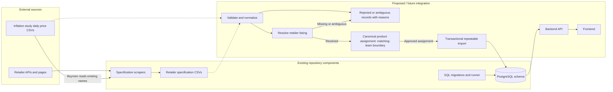
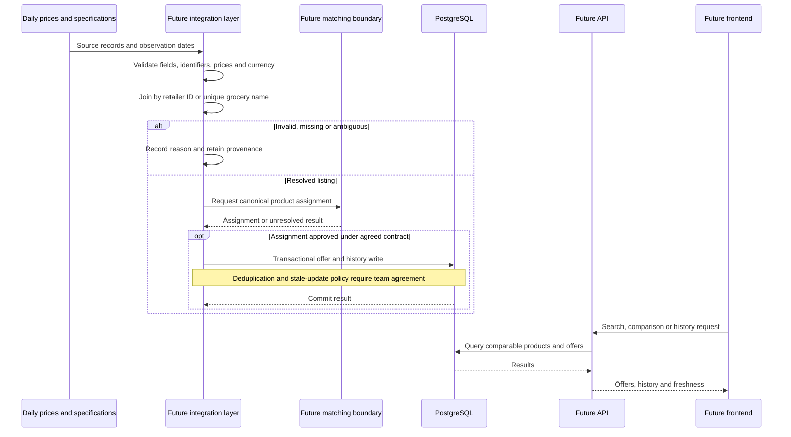
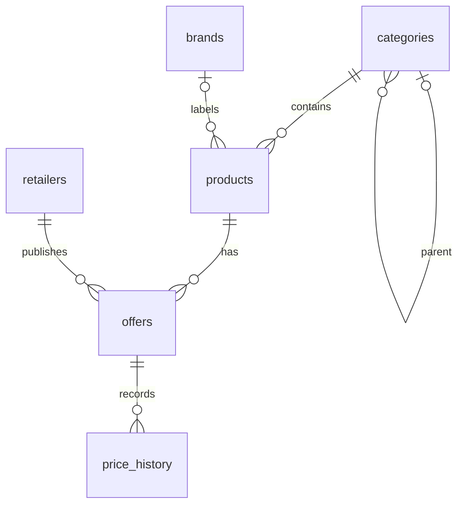

# System architecture and data flow

Status: Week 1 proposal, 2026-11-05. Baseline: fork main at `f53cb3c`.

## Existing components

The repository has specification scrapers, retailer specification CSVs, PostgreSQL migrations and a migration runner. Daily price CSVs are produced externally. No integrated importer, backend API, frontend or cross-retailer matching pipeline is present in the reviewed tree.

## Proposed boundaries

The integration stages below are responsibilities to agree, not new implemented services. They may eventually run in one process; this diagram does not prescribe microservices, frameworks, queues or hosting.

Solid connections inside the existing group describe available component relationships; all connections involving future components are proposed. The schema exists as SQL; this does not assert a deployed database.

## Proposed end-to-end sequence

## Existing database relationships

The schema also has `schema_migrations`. Category self-parenting is prohibited, but longer cycles are not prevented by that check.

## Ownership boundaries to confirm

Data collection owns source extraction and source-format documentation; matching owns canonical product and hierarchy decisions; database/backend owns persistence and API contracts; system integration coordinates contracts, environment setup, test evidence and deployment planning. These are proposed responsibility boundaries, not assignments of unapproved work.

See [open decisions](integration-contract.md). No frontend, backend, importer or matching algorithm is implemented by this documentation.
